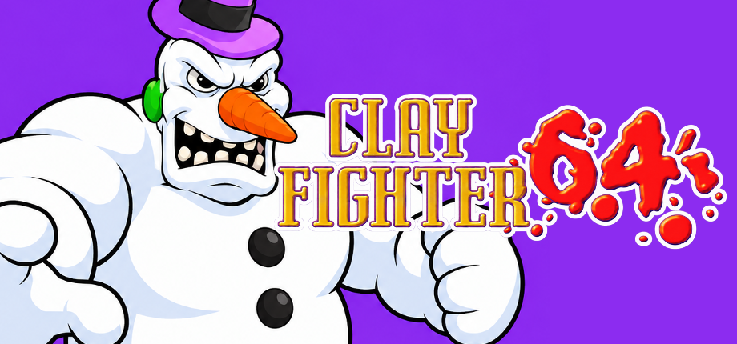

  

> This project was created with AI assistance. If that's not your cup of tea, feel free to move along.

# ClayFighter 64

**Version 1.0 — Linux and Windows x86-64.** [Download ClayFighter 64](https://github.com/djultra64/ClayFighter64/releases/latest).

A community PC port and fusion of **ClayFighter 63⅓** and **ClayFighter: Sculptor's Cut**, built through static recompilation with N64Recomp, N64ModernRuntime, RSPRecomp, and RT64.

This is an independent fan project, with no affiliation with or endorsement from the original developers, publisher, or rights holders. Project direction, original port work and playtesting: **djultra64**.

## Why ClayFighter 64?

I call this project **ClayFighter 64** because I consider this combination a finished version of the game I wanted: the best of ClayFighter 63⅓, with the additional characters from Sculptor's Cut.

For me, **63⅓ has the more complete gameplay**, and I really like **Killer Instinct's combo system**. That preference is why I chose 63⅓ as the gameplay foundation rather than replacing it with Sculptor's Cut's rules. These are my personal design preferences, not a claim that one version is universally better. This project does not import Killer Instinct code or characters.

Sculptor's Cut contributes **High Five, Lady Liberty, Lockjaw, and Zappa**, including their authentic character assets, portraits, and biographies. Combining that expanded cast with the 63⅓ foundation is what makes this my preferred, complete edition. It is a fusion with a deliberate gameplay choice, rather than a wholesale recreation of every difference in Sculptor's Cut.

## Why these decisions?

- **Keep the 63⅓ foundation.** The recompiled CPU and RSP audio code, gameplay rules, and combat framework remain based on 63⅓. This preserves the gameplay and combo feel that motivated the project.
- **Bring over the additional cast.** Sculptor's Cut adds the four characters missing from the original roster. Their donor assets are adapted within verified ranges to work with the 63⅓ framework; the native selector expands to sixteen playable slots.
- **Make the complete roster accessible.** Sumo Santa, Dr. Kiln, and Boogerman are unlocked from startup. The additional four characters appear in the right-hand selector column.
- **Preserve the game's presentation.** The native menus, clay artwork, fonts, biographies, and animations remain central. The title reads 64, and the PC options extend the original interface.
- **Require both original games.** Each ROM supplies a different part of the fusion. The installer validates both exact USA revisions and extracts the required data locally.

Version 1.0 is the release designation for this finished combination. It does not mean every possible hardware configuration or every game scenario has been tested; see the recorded validation limits below.

## Features

- Native Linux and Windows x86-64 executables, RT64 rendering, and recompiled RSP audio.
- Sixteen-character native selector, authentic portraits, and Sculptor's Cut biographies.
- 4:3 and 16:9 presentation, resolutions up to 2160p, filtering, fullscreen, MSAA, and presentation targets up to 120 fps.
- Original 60 Hz simulation. Actual presentation depends on the GPU and display; interpolation does not generate new clay sprite poses.
- Keyboard and two-controller support, per-action combat remapping, and device-aware prompts.
- Native **Options → Display**, **Game Display**, and **Button Remap**, with saved preferences.
- Native **Exit game** entry and the updated ClayFighter 64 title announcement.

## Requirements

- An x86-64 CPU with SSSE3 and SSE4.1, and a GPU/driver supporting Vulkan.
- Linux: X11 or XWayland, Python 3.10 or later for installation and launch, and the system runtime versions listed in [installation requirements](docs/INSTALL.md).
- Windows: Windows 10/11 x64. The installer includes its own Python runtime and the required release DLLs.
- **BOTH of your own supported USA ROMs: ClayFighter 63⅓ AND ClayFighter: Sculptor's Cut.** One ROM alone cannot install the fusion.

No ROMs, extracted original game assets, or original game recordings are included or downloaded. The package includes the project artwork and the user-supplied replacement title announcement. Keep imported game data private; do not attach it to issues or pull requests.

## Download and play

1. Download the Linux or Windows **1.0** package from [Releases](https://github.com/djultra64/ClayFighter64/releases/latest), then extract the entire archive into a writable folder.
2. Run **Install Assets.sh** on Linux or **Install Assets.cmd** on Windows.
3. Supply **both** USA ROM paths when prompted. The installer identifies them by their contents, so either order is accepted. It supports `.z64`, `.v64`, `.n64`, and ZIP files containing exactly one ROM.
4. Run **Play ClayFighter 64.sh** on Linux or **Play ClayFighter 64.cmd** on Windows. First launch also offers installation if the required local data is absent.

The installer creates the base ROM, combined character/portrait image, and biography data locally. Keep the generated `local/` and `probe-output/` folders when updating. Display and control preferences live in the SDL user-data directory for `djultra64/ClayTality64`; the historical folder name is retained for compatibility.

For exact ROM hashes, command-line installation, updates, and troubleshooting, see [INSTALL.md](docs/INSTALL.md).

## Controls and options

Actions map to physical button positions. Names and glyphs follow the last active input device, including the swapped A/B and X/Y names on Nintendo Switch controllers.

| Action | Xbox | PlayStation | Nintendo Switch | Keyboard |
| --- | --- | --- | --- | --- |
| Move / navigate | Left stick / D-pad | Left stick / D-pad | Left stick / D-pad | Arrow keys |
| Primary / confirm | A (south) | Cross (south) | B (south) | Z |
| Secondary / back | B (east) | Circle (east) | A (east) | X |
| Start / pause | Menu / Start | Options | + | Enter |

Other keyboard defaults: **Shift** for Z trigger, **Q/E** for L/R, and **I/K/J/L** for C up/down/left/right. **Options → Button Remap** changes combat actions; menu and pause navigation retain their defaults. Two controllers route to P1/P2 independently; keyboard remains on P1.

Use **Auto/Xbox/PlayStation/Switch** in Button Remap, or `--family auto|xbox|playstation|switch`, when automatic detection is ambiguous. Saved remapping overrides combat defaults.

## Validation and limitations

The latest game revision was previously validated with 31 Linux and 50 Windows native checks, including selector, biographies, input, rendering helpers, audio, and lifecycle behavior. Release packaging adds clean two-ROM installation, byte-order/ZIP handling, extracted-data parity, missing/wrong-ROM diagnostics, and packaged startup checks. See [the 1.0 validation report](docs/VALIDATION_1.0.md) for the final results.

The Windows GPU validation uses an RTX 2060 on a 60 Hz display. A requested 120 fps target is not proof of physical 120 Hz presentation. Real Xbox, PlayStation, and Switch controller verification remains pending when that hardware is available. Automated checks cover recorded scenarios and do not establish exhaustive character/mode coverage.

## Build and contribute

[Source and build prerequisites](docs/BUILD.md) describe ROM-derived code generation, the pinned SDK, the separate Windows build, and the source archive accompanying this release. ROMs and generated game data remain local. Please report issues with version, OS, GPU/driver, controller family, settings, and reproducible steps.

## AI Disclosure

I use **OpenAI Codex** to assist with research, reverse-engineering analysis, code implementation, debugging, tests, builds, packaging, and documentation. I direct that work, contribute code reviews and ideas for implementation, evaluate the game's behavior through hands-on testing, and decide which changes and releases to accept. Validation claims remain limited to the recorded builds and scenarios.

The original game and the upstream tools remain the work of their respective creators, credited in [CREDITS.md](CREDITS.md).

## Credits and licensing

See [CREDITS.md](CREDITS.md), [NOTICE](NOTICE), and the `licenses/` inventory for the original games, tools, artwork, supporting libraries, and preserved upstream notices. Newly authored port code is licensed under **GPL-3.0-or-later**; see [LICENSE](LICENSE). Dependencies keep their own licenses. This code license does not grant rights to original game material, trademarks, or project branding images.
